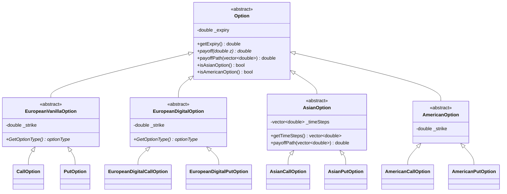
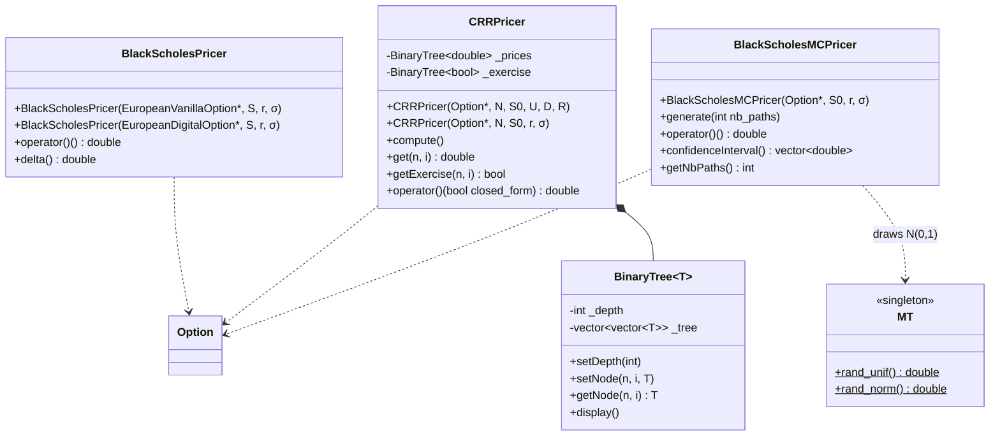

# C++ Derivatives Pricing

An object-oriented C++ library for pricing equity options with three standard methods: **Black-Scholes closed-form formulas**, the **Cox-Ross-Rubinstein binomial tree**, and **Monte Carlo simulation**.

Academic project, *C++ for Finance* course, ESILV (2026).

| Method | Options priced | Outputs |
|---|---|---|
| Black-Scholes (closed form) | European vanilla & digital | Price, Delta |
| Cox-Ross-Rubinstein tree | European vanilla & digital, **American** | Price, full price tree, early-exercise policy |
| Monte Carlo | European vanilla & digital, **Asian** (path-dependent) | Price, 95% confidence interval |

---

## Highlights

- **Polymorphic option hierarchy.** Every product derives from an abstract `Option` class, so each pricer works on any option through a base-class pointer. Adding a new payoff requires no change to the pricers.
- **Binomial tree as a generic template.** `BinaryTree<T>` stores option prices (`double`) and the American early-exercise policy (`bool`) with the same code.
- **Binomial → Black-Scholes convergence.** The CRR pricer can be calibrated from `(r, σ)`; prices converge to the Black-Scholes value as the number of steps grows.
- **Memory-efficient Monte Carlo.** Paths are never stored. The estimator and its variance are updated incrementally, so the price can be refined batch by batch.
- **Singleton random number generator.** A single `std::mt19937` instance is shared by the whole program.
- **Input validation.** Exceptions are thrown on negative strikes or maturities, arbitrage in the binomial model (`D < R < U` violated), or an Asian option passed to the tree pricer.

---

## Architecture

### Option hierarchy



`payoff(double)` is pure virtual: each concrete class defines its own payoff function. `payoffPath` returns `payoff(S_T)` by default and is overridden by `AsianOption` to apply the payoff to the average price along the path.

### Pricers



### Files

| Area | Files |
|---|---|
| Option base | `Option` |
| European options | `EuropeanVanillaOption`, `CallOption`, `PutOption` |
| Digital options | `EuropeanDigitalOption`, `EuropeanDigitalCallOption`, `EuropeanDigitalPutOption` |
| Asian options | `AsianOption`, `AsianCallOption`, `AsianPutOption` |
| American options | `AmericanOption`, `AmericanCallOption`, `AmericanPutOption` |
| Pricers | `BlackScholesPricer`, `CRRPricer`, `BlackScholesMCPricer` |
| Utilities | `BinaryTree.h` (header-only template), `MT` (RNG singleton) |

Each class has a `.h` declaration and a `.cpp` implementation, except `BinaryTree`, which is header-only because it is a template.

---

## Models

### Black-Scholes

Closed-form prices and deltas, with $N(x) = \tfrac{1}{2}\,\mathrm{erfc}(-x/\sqrt{2})$:

$$d_1 = \frac{\ln(S/K) + (r + \sigma^2/2)\,T}{\sigma\sqrt{T}}, \qquad d_2 = d_1 - \sigma\sqrt{T}$$

| Option | Price | Delta |
|---|---|---|
| Call | $S\,N(d_1) - K e^{-rT} N(d_2)$ | $N(d_1)$ |
| Put | $K e^{-rT} N(-d_2) - S\,N(-d_1)$ | $N(d_1) - 1$ |
| Digital call | $e^{-rT} N(d_2)$ | $e^{-rT}\,\varphi(d_2) / (\sigma S \sqrt{T})$ |
| Digital put | $e^{-rT} N(-d_2)$ | $-e^{-rT}\,\varphi(d_2) / (\sigma S \sqrt{T})$ |

### Cox-Ross-Rubinstein binomial tree

At each step the asset moves up by $1+U$ or down by $1+D$, so $S(n,i) = S_0 (1+U)^i (1+D)^{n-i}$. Prices are computed by backward induction with the risk-neutral probability $q = (R-D)/(U-D)$:

$$H(n,i) = \frac{q\,H(n+1,i+1) + (1-q)\,H(n+1,i)}{1+R}$$

- **American options:** at each node, $H(n,i) = \max(\text{continuation value},\ h(S(n,i)))$. The early-exercise decision is stored in a `BinaryTree<bool>`.
- **Closed form (European):** $H(0,0) = (1+R)^{-N} \sum_i \binom{N}{i} q^i (1-q)^{N-i}\, h(S(N,i))$, computed in log space to stay stable for large $N$.
- **Black-Scholes calibration:** with $h = T/N$, $\ U = e^{(r+\sigma^2/2)h + \sigma\sqrt{h}} - 1$, $\ D = e^{(r+\sigma^2/2)h - \sigma\sqrt{h}} - 1$, $\ R = e^{rh} - 1$.

### Monte Carlo

Paths are simulated exactly under the risk-neutral measure:

$$S_{t_k} = S_{t_{k-1}} \exp\!\Big(\big(r - \tfrac{\sigma^2}{2}\big)(t_k - t_{k-1}) + \sigma\sqrt{t_k - t_{k-1}}\,Z_k\Big), \quad Z_k \sim \mathcal{N}(0,1)$$

The price is $e^{-rT}$ times the average payoff. The 95% confidence interval is $\hat{H} \pm 1.96\,\hat{s}/\sqrt{n}$. Asian options use their observation dates $(t_1,\dots,t_m)$; European options use a single step to $T$.

---

## Results

Parameters: $S = K = 100$, $T = 1$, $r = 5\%$, $\sigma = 20\%$.

| Product | Black-Scholes | CRR (N = 1000) | Monte Carlo (10⁶ paths) |
|---|---|---|---|
| European call | 10.4506 | 10.4523 | 10.460, 95% CI [10.431, 10.489] |
| European put | 5.5735 | 5.5752 | 5.586, 95% CI [5.569, 5.603] |
| Digital call | 0.5323 | — | 0.5325 |
| American put | — | 6.0915 | — |
| American call | — | 10.4523 (= European, no dividends) | — |

CRR convergence to Black-Scholes for the European call:

| N | 10 | 100 | 1000 |
|---|---|---|---|
| CRR price | 10.6238 | 10.4588 | 10.4523 |

---

## Usage

```cpp
#include <iostream>
#include "CallOption.h"
#include "AmericanPutOption.h"
#include "AsianCallOption.h"
#include "BlackScholesPricer.h"
#include "CRRPricer.h"
#include "BlackScholesMCPricer.h"

int main() {
    double S0 = 100, r = 0.05, sigma = 0.2;

    // Black-Scholes closed form
    CallOption call(1.0, 100);                      // expiry, strike
    BlackScholesPricer bs(&call, S0, r, sigma);
    std::cout << "BS price: " << bs() << ", delta: " << bs.delta() << "\n";

    // American put on a binomial tree calibrated to Black-Scholes
    AmericanPutOption put(1.0, 100);
    CRRPricer crr(&put, 1000, S0, r, sigma);        // N = 1000 steps
    std::cout << "American put: " << crr() << "\n";

    // Asian call by Monte Carlo, monthly averaging
    std::vector<double> dates;
    for (int k = 1; k <= 12; k++) dates.push_back(k / 12.0);
    AsianCallOption asian(dates, 100);
    BlackScholesMCPricer mc(&asian, S0, r, sigma);
    mc.generate(1000000);
    std::vector<double> ci = mc.confidenceInterval();
    std::cout << "Asian call: " << mc() << " [" << ci[0] << ", " << ci[1] << "]\n";
}
```

### Build

Requires a C++17 compiler. With g++:

```bash
g++ -std=c++17 -O2 *.cpp -o pricer
./pricer
```

The repository contains no `main()` (the course grading uses its own). Add one, such as the example above, to build an executable.

---

## Tech stack

C++17 · STL (`vector`, `<random>`, `<cmath>`) · object-oriented design (abstract classes, virtual dispatch, templates, singleton)
